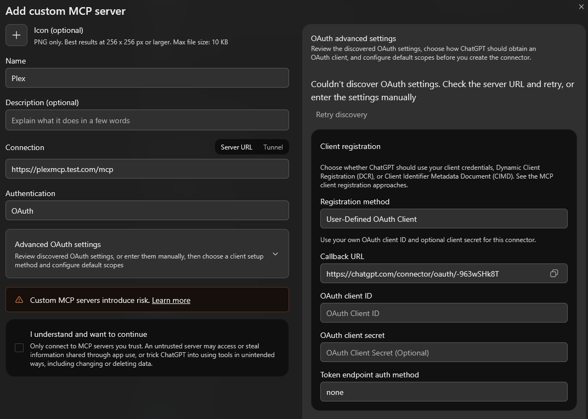

# Plex MCP Server

An MCP server for managing Plex libraries, media, and playback from Claude, ChatGPT, and other MCP clients.

## Features

- **JSON responses**: Structured results for Plex operations.
- **Multiple Transports**: Supports `stdio`, SSE (Server-Sent Events), and Streamable HTTP.
- **Comprehensive Control**: Manage libraries, media, collections, playlists, clients, and users.
- **Remote Ready**: Built-in OAuth 2.1 support for integration with remote AI platforms like Claude.ai.
- **Admin Tools**: Access logs, monitor bandwidth, and run Butler tasks.

## Installation

### Option 1: Using uv (Recommended)

Run directly without installation:
```bash
uvx plex-mcp-server --transport stdio --plex-url http://your-server:32400 --plex-token your-token
```

### Option 2: Install via pip

```bash
pip install plex-mcp-server
```

### Option 3: Development / Source

```bash
git clone https://github.com/vladimir-tutin/plex-mcp-server.git
cd plex-mcp-server
pip install -e .
```

### Option 4: Docker

The published image is `ghcr.io/vladimir-tutin/plex-mcp-server:latest` for Linux
amd64 and arm64. It runs as a non-root user and serves Streamable HTTP at `/mcp`
and legacy SSE at `/sse`. No media folders need to be mounted: it uses Plex's API.

Follow the Docker setup below, then see
[Public HTTPS access](#public-https-access) for hosted clients such as Claude.ai or ChatGPT.

#### Docker Compose

```bash
git clone https://github.com/vladimir-tutin/plex-mcp-server.git
cd plex-mcp-server
cp .env.docker.example .env
```

Edit `.env` before starting. For a trusted LAN deployment, for example:

```env
PLEX_URL=http://192.168.1.10:32400
PLEX_TOKEN=your-plex-token
MCP_BIND_ADDRESS=192.168.1.20
MCP_PUBLISHED_PORT=3001
MCP_SERVER_URL=http://192.168.1.20:3001
MCP_OAUTH_ENABLED=false
```

Replace `192.168.1.10` with the Plex address and `192.168.1.20` with the Docker
host's address. Without OAuth, anyone who can reach this port can use the tools.
The supplied example file defaults to loopback (`127.0.0.1`) instead, for access
from the Docker host only. Keep `.env` private.

```bash
docker compose pull
docker compose up -d --no-build
docker compose logs -f
```

The LAN example's client URL is `http://192.168.1.20:3001/mcp`. Hosted clients
need a reachable HTTPS endpoint; follow [Public HTTPS access](#public-https-access).

#### Other Docker deployments

Use `ghcr.io/vladimir-tutin/plex-mcp-server:latest`, publish container port
`3001` (TCP), and set these environment variables:

| Key | Example value |
|---|---|
| `PLEX_URL` | `http://192.168.1.10:32400` |
| `PLEX_TOKEN` | `your-plex-token` |
| `MCP_SERVER_URL` | `http://192.168.1.20:3001` |
| `MCP_TRANSPORT` | `streamable-http` (default; serves both `/mcp` and `/sse`) |

Use your Docker host's address and published port in `MCP_SERVER_URL`.
`MCP_BIND_ADDRESS` and `MCP_PUBLISHED_PORT` only configure this repository's
Compose file; for other deployments, set the port mapping directly.

#### Public HTTPS access

Setting `MCP_SERVER_URL` does **not** create DNS records, configure HTTPS, or
publish the container. Complete these steps before connecting a hosted client:

1. Create an OAuth provider using [Remote Access & OAuth](#remote-access--oauth).
2. Set these values in Compose's `.env` or your container's environment:

   ```env
   MCP_SERVER_URL=https://plexmcp.example.com
   MCP_OAUTH_ENABLED=true
   MCP_OAUTH_ISSUER=https://auth.example.com/application/o/plexmcp-oauth/
   MCP_OAUTH_AUDIENCE=your-oauth-client-id
   ```

   Keep `PLEX_URL` and `PLEX_TOKEN` set as above. These are separate from your
   OAuth credentials. `MCP_SERVER_URL` is the public **base URL**, without `/mcp`
   or `/sse`. `MCP_OAUTH_ISSUER` is the provider's exact issuer URL,
   including its path and trailing slash.
3. Point the public hostname at your reverse proxy and configure a valid HTTPS
   certificate. Forward that hostname to the MCP container's published address,
   for example `http://192.168.1.20:3001`. This is the Docker host and
   **host port**, not Plex's port `32400` or Authentik's address.
4. Forward all paths on that hostname unchanged, preserve the public `Host` and
   `Authorization` headers, and allow streaming responses without buffering.
   With Compose, the published address must be reachable by the proxy: use the
   Docker host's LAN address when the proxy runs elsewhere. A proxy in another
   container cannot reach this container through its own `127.0.0.1`.
5. Let requests reach the MCP server's OAuth middleware rather than intercepting
   them with a browser-login page at the proxy. This includes `/mcp`, `/sse`,
   `/messages/`, `/.well-known/` discovery paths, `/authorize`, and `/token`.
   The MCP server validates bearer tokens; Authentik handles the OAuth login.
6. Recreate the container with the updated settings (`docker compose up -d --no-build`
   for Compose). Configure clients with `https://plexmcp.example.com/mcp` (Streamable HTTP)
   or `https://plexmcp.example.com/sse` (legacy SSE).

With OAuth enabled, an unauthenticated request to `/mcp` or `/sse` should return
**401**, while `/.well-known/oauth-protected-resource` should return JSON. A proxy
login page or a 502 indicates the request is not reaching the expected MCP handler.
Finish by signing in from your client and asking it to list your Plex libraries.

When moving an existing deployment, update the reverse proxy's upstream to the
new host and port. You can retain the public MCP URL and client URLs. If the OAuth
provider also moves, preserve its issuer URL and configuration or update
`MCP_OAUTH_ISSUER` and the client credentials to match.

#### Updating or building the image

`latest` tracks published releases; `edge` tracks main. Use a version tag such as
`1.2.0` to pin a release. Running containers do not update automatically.

For Compose, update with:

```bash
docker compose pull
docker compose up -d --no-build
```

To build from source, run `docker compose build --pull`, then
`docker compose up -d --no-build`.

To run the published image without Compose, prepare `.env` with the server
variables above and choose the host binding explicitly:

```bash
docker run -d --name plex-mcp-server --restart unless-stopped --init \
  --env-file .env -p 127.0.0.1:3001:3001 ghcr.io/vladimir-tutin/plex-mcp-server:latest
```

This command publishes on loopback only. For standalone SSE, append
`--transport sse --host 0.0.0.0 --port 3001`. For stdio, use
`docker run --rm -i --env-file .env ghcr.io/vladimir-tutin/plex-mcp-server:latest --transport stdio`
without publishing a port.

## Configuration

For containers, use the [Docker setup](#option-4-docker). The following options also
apply to direct Python installations. `PLEX_URL` points to Plex; `MCP_SERVER_URL`
is the address of this MCP service. Inside a container, `localhost` refers to the
container itself, so use a reachable network address for Plex.

Set your Plex server URL and Token using one of these methods:

### 1. Command Line Arguments
```bash
plex-mcp-server --plex-url "http://192.168.1.10:32400" --plex-token "ABC123XYZ"
```

### 2. Environment Variables (.env)
Create a `.env` file in the current directory or `~/.config/plex-mcp-server/.env`:
```env
PLEX_URL=http://localhost:32400
PLEX_TOKEN=your-authentication-token
MCP_OAUTH_ENABLED=false
```
For OAuth settings, see [Remote Access & OAuth](#remote-access--oauth).

### 3. MCP Client Config
Example for Claude Desktop (`%APPDATA%/Claude/claude_desktop_config.json`):
```json
{
  "mcpServers": {
    "plex": {
      "command": "uvx",
      "args": [
        "plex-mcp-server",
        "--transport",
        "stdio",
        "--plex-url",
        "http://your-server:32400",
        "--plex-token",
        "your-token"
      ]
    }
  }
}
```
#### Remote servers from stdio-only clients

If your client only supports launching a local stdio process, use
[`mcp-remote`](https://github.com/geelen/mcp-remote) to connect it to a remote Plex MCP
server. Install Node.js (which provides `npx`) on the client machine, then use:

```json
{
  "mcpServers": {
    "plex": {
      "command": "npx",
      "args": ["-y", "mcp-remote", "https://plexmcp.example.com/mcp"]
    }
  }
}
```

Use `/mcp` when the server runs with `--transport streamable-http`. For an SSE
deployment, use `/sse` instead. For plain HTTP on a trusted private network, append
`"--allow-http"` to the arguments. If OAuth is enabled, follow the bridge's
[OAuth configuration instructions](https://github.com/geelen/mcp-remote#readme),
including any required client credentials and callback registration.

Clients with native remote HTTP support can connect directly to `/mcp` and do not
need Node.js, `npx`, or this bridge. The local stdio setup above also needs no bridge.

### 4. Claude Connector Installation

Go to https://claude.ai/settings/connectors and add a new connector with the following settings:
- Name: Plex MCP
- URL: `https://plexmcp.example.com/sse` for SSE, or `https://plexmcp.example.com/mcp` when running with `--transport streamable-http`.
- If OAuth is enabled, enter your provider's Client ID and Client Secret in the advanced settings and complete sign-in.

Register Claude's callback in your OAuth provider: `https://claude.ai/api/mcp/auth_callback`.
See [Remote Access & OAuth](#remote-access--oauth) for provider and reverse-proxy configuration.


### 5. ChatGPT Connector Installation

Start the server with `--transport streamable-http` and make it reachable at a public HTTPS URL.
In ChatGPT's plugin settings, choose **Add custom MCP server**:

- Name: Plex MCP
- Server URL: `https://plexmcp.example.com/mcp`
- Authentication: **OAuth** if enabled on the server; otherwise **None**.
- For a confidential OAuth client, open **Advanced OAuth settings** and supply your provider's Client ID and Client Secret. These are separate from your Plex token.



The screenshot shows where to find the OAuth settings if your server requires them.
It uses a placeholder server URL, so discovery fails in this example. Use your real
server URL and the token endpoint authentication method required by your provider.

Register the exact ChatGPT callback URL with your OAuth provider. It can look like
`https://chatgpt.com/connector/oauth/<callback-id>`; use the value requested by your
connection, not the literal placeholder. Create the plugin, complete sign-in, and
refresh its tools. Test it by asking ChatGPT to list your Plex libraries.

For reverse-proxy routing, see [Public HTTPS access](#public-https-access).

The website plugin and a local Codex MCP entry are separate connections. For local
Codex OAuth configuration, see the [client setup instructions](#3-configure-each-client).


## Streamable HTTP

Start the server with `--transport streamable-http` to expose `/mcp`:

```bash
plex-mcp-server --transport streamable-http --port 3001 --server-url https://plexmcp.example.com
```

Configure your client with `https://plexmcp.example.com/mcp`. This mode also keeps
the legacy `/sse` and `/messages/` endpoints available for existing clients.
Set `MCP_TRANSPORT` in `.env` or your container's environment to select
`streamable-http`, `sse`, or `stdio`. An explicit `--transport` flag overrides it.
Docker defaults to `streamable-http`, serving both `/mcp` and legacy `/sse`.
Direct execution defaults to `sse` when neither the variable nor flag is supplied.
For Docker stdio, the MCP client must launch the container with `docker run --rm -i`;
no port mapping is needed.

OAuth is optional on both HTTP transports. Enable it with `--oauth-enabled` or
`MCP_OAUTH_ENABLED=true`, using the issuer settings below. Without OAuth, anyone
who can reach the endpoints can call the tools; use an appropriate network boundary.

Both SSE and Streamable HTTP validate Host and Origin headers to block DNS-rebinding
attacks (a malicious web page driving your server through your browser). `--server-url`
(or `MCP_SERVER_URL`) permits your public hostname and origin even with OAuth disabled.
For additional proxy names, LAN addresses, or browser origins, set comma-separated
`MCP_ALLOWED_HOSTS` and `MCP_ALLOWED_ORIGINS` (e.g. `MCP_ALLOWED_HOSTS=192.168.1.20:3001`).
Loopback hosts are allowed by default. If a remote client gets `421 Invalid Host header`,
add its host and port to `MCP_ALLOWED_HOSTS`. For a rejected browser origin,
add the full origin (scheme, host, and port) to `MCP_ALLOWED_ORIGINS`.

## Remote Access & OAuth

OAuth protects both HTTP transports. The following setup uses Authentik as the identity provider.

### How it works
The MCP server acts as the OAuth front door: clients discover it via
`/.well-known/oauth-protected-resource`, are sent to `/authorize` (which redirects to
your identity provider), and exchange codes at `/token` (which the server proxies to the
provider). Clients therefore only ever need **your MCP server URL** plus the provider's
Client ID / Secret. The browser visits the provider to complete sign-in. Access tokens are JWTs
validated against the provider's JWKS; the server checks signature, expiry, issuer, and
(optionally) audience on every request, on both SSE and Streamable HTTP.

### 1. Create an OAuth provider (Authentik example)
1. **Providers → Create → OAuth2/OpenID Provider.** Client type *Confidential*, signing
   key set (RS256). Note the **Client ID** and **Client Secret**.
2. **Redirect URIs** — add one entry per client you plan to use. These are the values
   seen in practice:

   | Client | Redirect URI |
   |---|---|
   | Claude.ai / Claude Desktop | `https://claude.ai/api/mcp/auth_callback` |
   | ChatGPT connector | `https://chatgpt.com/connector/oauth/<connector-id>` — shown in the connector dialog |
   | Codex CLI / local tools | loopback, random port: regex `^http://127\.0\.0\.1:[0-9]+/callback/<callback-id>$` |

   Keep this list tight. A catch-all like `.*` lets anyone who can get you to click a
   link capture an authorization code.
3. **Applications → Create**, bind it to the provider, and **bind an access policy**
   (your user or group). Any Authentik user who can authorize this application gets full
   control of Plex — there are no per-user roles inside the MCP server.
4. Copy the provider's **OpenID Configuration Issuer** URL, e.g.
   `https://auth.example.com/application/o/plexmcp-oauth/` (trailing slash included).

### 2. Configure the server

For Docker, enter these as environment variables using the
[public HTTPS setup](#public-https-access), which also covers DNS and the reverse proxy.

```env
MCP_OAUTH_ENABLED=true
MCP_OAUTH_ISSUER=https://auth.example.com/application/o/plexmcp-oauth/
MCP_SERVER_URL=https://plexmcp.example.com
MCP_OAUTH_AUDIENCE=<Client ID>        # optional, recommended
```
or the equivalent flags: `--oauth-enabled --oauth-issuer … --server-url … --oauth-audience …`.

- `MCP_SERVER_URL` must be the public HTTPS URL clients reach; it also becomes the
  allowed Host/Origin for DNS-rebinding protection. Use the base URL without `/mcp`
  or `/sse`; HTTPS is provided by your reverse proxy.
- `MCP_OAUTH_AUDIENCE` makes the server reject tokens minted for any *other* client of
  the same provider. Set it to the Client ID from step 1. Leaving it unset disables audience validation for compatibility with existing deployments.

### 3. Configure each client
Use the Client ID and Secret from step 1 and one of these URLs:

| Client | URL | Notes |
|---|---|---|
| Claude.ai / Claude Desktop | `https://plexmcp.example.com/sse` | Claude probes with a Streamable HTTP POST first and falls back to SSE automatically |
| ChatGPT | `https://plexmcp.example.com/mcp` | Authentication: OAuth, paste Client ID/Secret |
| Codex CLI | `codex mcp add plex --url https://plexmcp.example.com/mcp --oauth-client-id <id> --oauth-client-secret <secret>` | opens a browser for login |

Clients configured with `/mcp` use Streamable HTTP; `/sse` uses the legacy transport.
Both are protected identically.

### Discovery Endpoints
When OAuth is active, the following standard endpoints are exposed without
authentication:
- `/.well-known/oauth-protected-resource`
- `/.well-known/oauth-authorization-server`
- `/authorize` (redirects to the provider) and `/token` (proxied to the provider)

## Command Reference

### Library Module
Tools for exploring and managing your Plex libraries.

| Command | Description | Parameters |
|---------|-------------|------------|
| `library_list` | Lists all available libraries. | None |
| `library_get_stats` | Gets statistics (count, size, types) for a library. | `library_name` |
| `library_refresh` | Triggers a metadata refresh for a library. | `library_name` |
| `library_scan` | Scans a library for new files. | `library_name` |
| `library_get_details` | Gets detailed information about a library. | `library_name` |
| `library_get_recently_added` | Lists recently added items in a library. | `library_name`, `limit: int` |
| `library_get_contents` | Lists current library items with media IDs, filters, and pagination. | `library_name` (optional), `media_type`, `watched: bool`, `unwatched: bool`, `offset: int`, `limit: int`, `sort`, `title`, `genre`, `year`, `content_rating`, `director`, `actor`, `writer`, `resolution`, `network`, `studio`, `username` |

To list watched movies currently in your library (rather than playback history):

```json
{"library_name": "Movies", "watched": true, "offset": 0, "limit": 50}
```

Each result includes `media_id` (Plex's `ratingKey`) for looking up or deleting that
specific item. The default page size is 50; increase `offset` to retrieve later pages.
`totalItems` is the count matching the server-side filters, not just the current page.
Use `title` to combine a case-insensitive Plex title search with other filters:
`{"library_name":"Movies","title":"Avengers","watched":true}`.
This returns all matches with normal pagination. It is not exact-only or arbitrary
substring matching: `Avengers` matches titles containing that word, while `venger`
does not. Title searches use the selected media type; TV libraries default to show names.
Watch state belongs to the selected `username`, or the configured account when omitted.

To search across all accessible libraries, omit `library_name` and supply `media_type`:

```json
{"media_type":"movie","watched":true,"genre":"Action"}
```

Supported types are `movie`, `show`, `episode`, `artist`, `album`, and `track`.
You can also select a type within a named library, such as `episode` in a TV library
or `track` in a music library. Type-selected results include the originating `library`
and `library_id`; episodes include their show/season/episode and tracks their artist/album.
Filters and sorting apply before pagination across the combined results. At least
one of `library_name` or `media_type` is required. Broad episode queries can be slower
on large libraries; a library or title filter narrows the search.

For music, `watched`/`unwatched` select played/unplayed items. Artist and album played
state does not imply every track is complete.

Movie, episode, and track results also include `inProgress` and `progressPercent`, based on Plex's
saved playback offset, even if the movie is absent from Continue Watching.
`inProgress` is true when that offset is positive; it does not mean the movie is
currently playing. `progressPercent` is the saved position as a percentage of
duration, rounded to one decimal and bounded to 0-100 (null if duration is unknown).
A movie with no saved position has `inProgress: false` and, when duration is known,
`progressPercent: 0`, even if it was previously watched.

These fields are independent of `watched`: a movie can be both watched and in
progress, for example during a rewatch. The `watched` and `unwatched` filters still
use Plex's watched state, not saved progress. For cleanup, inspect `inProgress`
as well as `watched` to avoid selecting movies with a saved playback position.

For shows, `watched=true` selects series with no unwatched episodes;
`unwatched=true` selects those with episodes remaining, including partially watched
series. Results include `watchStatus` (`unwatched`, `partial`, or `watched`),
`watchedEpisodeCount`, and `episodeCount`. Completion refers to episodes currently
in the library, not future or missing episodes. Empty shows report `watched=false`.
Do not set both filters to true.

Filters must apply to the selected media type; unsupported combinations return an
error rather than being silently ignored. Episode genre, rating, people, network,
and studio filters use the parent show. Track year and studio use the parent album.
Artist filters support title and genre; albums and tracks also support year and studio.
Resolution applies to movies and episodes (`sd`, `480`, `576`, `720`, `1080`, `2k`,
`4k`, or `8k`).

### Media Module
Tools for searching, inspecting, and editing specific media items.

| Command | Description | Parameters |
|---------|-------------|------------|
| `media_search` | Search for media across all libraries. | `query`, `library_name`, `content_type` |
| `media_get_details` | Get comprehensive details for an item. | `media_title`, `library_name`, `media_id`, `username` |
| `media_set_watched_status` | Mark an item watched or unwatched. Shows, seasons, albums and artists apply to every episode or track, including partly watched ones. | `media_id`, `watched`, `username` |
| `media_edit_metadata` | Update tags, genres, summary, or title. | `media_title`, `library_name`, `new_title`, `new_summary`, `new_rating`, `new_release_date`, `new_genre`, `remove_genre`, `new_director`, `new_studio`, `new_tags` |
| `media_delete` | Remove an item from Plex. | `media_title`, `library_name`, `media_id`, `username` |
| `media_get_artwork` | Retrieve posters or background artwork. | `media_title`, `library_name`, `art_type: str` |
| `media_set_artwork` | Set artwork from a local path or URL. | `media_title`, `library_name`, `poster_path`, `poster_url`, `background_path`, `background_url` |
| `media_list_available_artwork` | List alternative artwork available for selection. | `media_title`, `library_name`, `art_type` |

`library_get_contents`, `media_get_details` and `media_set_watched_status` accept
`username` for a Home or shared user, using the configured admin credentials. Omit it
for your account.
Watched filters and saved playback progress belong to the selected user; failed
access returns an error. Movie, episode and track details include `watched`,
`view_count`, `playback_offset_ms`, `in_progress`, and `progress_percent`. Show,
season, album and artist details include `watched`, `watch_status` (`watched`, `partial` or
`unwatched`), `watched_count`, and `total_count`.

### Watchlist Module

Manage the Plex account Watchlist, including movies and shows outside your library.
Listings and search results include `release_date`, `duration_ms` (runtime in
milliseconds), and `content_rating` when Plex supplies them, without extra lookups.
The release date does not distinguish theatrical, physical, or streaming releases.

By default, listing also looks up the selected user's library state. Movies include saved
progress and watched status; shows include watched and total episode counts. Matching
uses Plex GUIDs first, then searches by title and verifies shared IMDb, TMDB, or TVDB
IDs. Each matching library copy is returned in `library_items`. Unmatched items have
unknown availability (`null`), not an unwatched state. Lookup failures leave the
Watchlist available with a `state_error`. Set `include_state=false` to skip library
lookups. Individual episode progress is not included.

| Command | Description | Parameters |
|---|---|---|
| `watchlist_list` | List Watchlist titles with local availability and watched/progress state. | `offset`, `limit` (1–100), `include_state` (default `true`) |
| `watchlist_search` | Search Plex Discover for titles to add. | `query`, `content_type` (movie/show), `limit` (1–100) |
| `watchlist_add` | Add a movie or show. | `guid` |
| `watchlist_remove` | Remove a movie or show. | `guid` |

Search first, then pass the chosen result's `guid` to `watchlist_add`. To remove
an entry, use its GUID from `watchlist_list`. These `plex://movie/...` or
`plex://show/...` identifiers are cloud IDs, not local `media_id`/`ratingKey` values.
List results default to 50 items; increase `offset` for the next page.

All four tools use the configured `PLEX_TOKEN`. Pass `username` to select a user
by exact username or profile title, or `home_user_id` to select by ID (takes
precedence). Supply `pin` if Plex requires it. If Plex cannot access that user's
Watchlist, the tool returns an error without falling back to your Watchlist.
Omit the selectors to use the configured account.
Add/remove operations confirm membership and leave media files and watched status unchanged.

### Playlist Module
Manage your personal and shared playlists.

| Command | Description | Parameters |
|---------|-------------|------------|
| `playlist_list` | List playlists. | `library_name`, `content_type`, `username` |
| `playlist_get_contents` | List playlist items. | `playlist_title`, `playlist_id`, `username` |
| `playlist_create` | Create a playlist. | `playlist_title`, `item_titles`, `library_name`, `summary`, `username` |
| `playlist_delete` | Delete a playlist. | `playlist_title`, `playlist_id`, `username` |
| `playlist_add_to` | Add media items. | `playlist_title`, `playlist_id`, `item_titles`, `item_ids`, `username` |
| `playlist_remove_from` | Remove playlist items. | `playlist_title`, `playlist_id`, `item_titles`, `username` |
| `playlist_edit` | Change title or summary. | `playlist_title`, `playlist_id`, `new_title`, `new_summary`, `username` |
| `playlist_upload_poster` | Upload a poster. | `playlist_title`, `playlist_id`, `poster_url`, `poster_filepath`, `username` |
| `playlist_copy_to_user` | Copy a playlist to another user. | `playlist_title`, `playlist_id`, `username`, `source_username` |

Pass `username` to work with a Home or shared user's playlists using the configured
admin credentials. Omit it to use the configured account. Failed access returns an
error. For `playlist_copy_to_user`, `username` is the destination; `source_username`
selects the source account and defaults to the configured account.

#### Smart playlists

Smart playlists save library filters that Plex reapplies as your library changes.
All three tools accept `username`, including Home and shared users.

| Tool | Purpose |
|---|---|
| `playlist_get_smart_filter_options` | Discover fields, operators, sorting and field values for `library_name` and optional `libtype`. |
| `playlist_create_smart` | Save `filters`, `sort`, `limit` and `libtype` as a playlist. |
| `playlist_edit_smart_filters` | Update a playlist by ID or title, preserving omitted settings. |

Use `libtype="show"` with `{"title": "Band of Brothers"}` to match the show.
Use `libtype="episode"` to match episode titles. Show and artist searches produce
playable episodes and tracks. Use the same `libtype` when discovering filters.

Creation and editing return the saved `definition`, item count and up to 20 items.
`playlist_get_contents` returns all current items and the saved definition.
On edit, omitted values remain unchanged; `{}` clears filters, an empty sort string
clears sorting, and `limit=0` removes the limit. `libtype` changes only when supplied.

### Collection Module
Organize movies and shows into collections.

| Command | Description | Parameters |
|---------|-------------|------------|
| `collection_list` | List collections in a specific library. | `library_name` |
| `collection_create` | Create a new collection. | `library_name`, `title`, `items: List[str]` |
| `collection_add_to` | Add items to an existing collection. | `library_name`, `collection_title`, `items: List[str]`, `collection_id` |
| `collection_remove_from` | Remove items from a collection. | `library_name`, `collection_title`, `items: List[str]`, `collection_id` |
| `collection_edit` | Edit collection metadata and settings. | `collection_title`, `collection_id`, `library_name`, `new_title`, `new_sort_title`, `new_summary`, `new_content_rating`, `new_labels`, `add_labels`, `remove_labels`, `poster_path`, `poster_url`, `background_path`, `background_url`, `new_advanced_settings` |
| `collection_delete` | Delete a collection. | `collection_title`, `collection_id`, `library_name` |

### User Module
Information about the server owner and shared users.

| Command | Description | Parameters |
|---------|-------------|------------|
| `user_search_users` | Search for shared users. | `search_term` |
| `user_list_all_users` | List all users with types and IDs. | None |
| `user_get_info` | Detailed info for a specific user. | `username` |
| `user_get_on_deck` | Get "On Deck" items for a user. | `username` |
| `user_get_continue_watching` | Get partially watched items to resume. | `limit`, `username`, `user_id` |
| `user_get_watch_history` | Retrieve personal watch history. | `username`, `limit`, `content_type`, `user_id` |
| `user_get_statistics` | Watch progress and usage statistics. | `time_period`, `username` |

`user_get_continue_watching` accepts an exact username/profile title or a `user_id`
from `user_list_all_users`. The ID takes precedence; omit both for the configured
account. Access to other users requires the server administrator's token and is
limited to this Plex server. Failed access returns an error.

### Sessions Module
Monitor real-time server activity.

| Command | Description | Parameters |
|---------|-------------|------------|
| `sessions_get_active` | Get currently playing items and clients. | None |
| `sessions_get_media_playback_history` | History for a specific media item. | `media_title`, `library_name`, `media_id`, `username` |

### Server Module
Maintenance and administrative tools.

| Command | Description | Parameters |
|---------|-------------|------------|
| `server_get_plex_logs` | Retrieve lines from Plex logs. | `num_lines`, `log_type`, `start_line`, `list_files`, `search_term` |
| `server_get_info` | Basic server health and version info. | None |
| `server_get_bandwidth`| Bandwidth usage statistics. | `timespan`, `lan` |
| `server_get_current_resources` | CPU/Memory usage of the host/process. | None |
| `server_get_butler_tasks` | List scheduled maintenance tasks. | None |
| `server_get_alerts` | Listen for server notifications/alerts. | `timeout` |
| `server_run_butler_task` | Manually trigger a Butler task. | `task_name` |
| `server_empty_trash` | Empty trash for libraries. | `library_name` |
| `server_optimize_database` | Run database optimization. | None |
| `server_clean_bundles` | Clean up unused media bundles. | None |

### Client Module
Control playback and navigation on Plex clients.

| Command | Description | Parameters |
|---------|-------------|------------|
| `client_list` | List all available playback clients. | `include_details: bool`, `active_only: bool` |
| `client_get_details` | Detailed info for a client. | `client_name`, `client_id` |
| `client_get_timelines` | Current playback state/trackers. | `client_name`, `client_id` |
| `client_start_playback` | Start playing a media item on a client. | `media_title`, `client_name`, `rating_key`, `offset`, `library_name`, `use_external_player` |
| `client_control_playback` | Play, Pause, Stop, Seek, Skip. | `client_name`, `action`, `offset`, `client_id` |
| `client_navigate` | Send remote control navigation commands. | `client_name`, `command`, `client_id` |
| `client_set_streams` | Changes audio or subtitle tracks. | `client_name`, `audio_stream_id`, `subtitle_stream_id`, `client_id` |

## Response Formats

All tools return information in JSON format for consistent parsing.

### Success Example
```json
{
  "status": "success",
  "data": {
    "title": "Inception",
    "year": 2010,
    "rating": 8.8
  }
}
```

### Error Example
```json
{
  "status": "error",
  "message": "Library 'Missing' not found."
}
```

### Multiple Matches
If an operation finds multiple items with the same name, it returns a list of specific identifiers:
```json
[
  {
    "title": "The Office",
    "id": 123,
    "type": "show",
    "year": 2005
  },
  {
    "title": "The Office",
    "id": 456,
    "type": "show",
    "year": 1995
  }
]
```

## Troubleshooting OAuth

- **401 Unauthorized**: Ensure your `MCP_OAUTH_ISSUER` exactly matches the issuer URL in your identity provider (including trailing slashes). If `MCP_OAUTH_AUDIENCE` is set, it must equal the client ID your provider puts in the token's `aud` claim.
- **Public URL**: `MCP_SERVER_URL` must be reachable by the client (e.g., plexmcp.example.com) and should use HTTPS.
- **Redirect URI mismatch** (provider error page after login): the client's callback isn't in the provider's redirect list — see the table in step 1. Use the exact callback requested by the client. For Codex, replace `<callback-id>` in the example with the actual callback ID; only the loopback port should vary.
- **Client hangs after login / "Couldn't connect"**: check the server log for `Token valid` vs `Token validation failed`. A failure right after a successful `/token` usually means `MCP_OAUTH_AUDIENCE` doesn't match the token's `aud` — unset it to confirm, then set it to the Client ID.
- **First request slow**: token validation caches discovery metadata until restart and caches JWKS for `MCP_OAUTH_JWKS_CACHE_TTL` seconds (default 3600). After rotating signing keys in the provider, restart the server or wait for the cache to expire.
